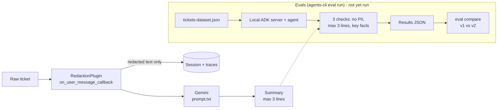

# Support-ticket summarizer (Agents CLI + ADK, local only)

Summarizes one payments support ticket in at most 3 lines. PII is removed **before** the model sees anything.

## How it works
- `app/redaction.py`: deterministic regex redaction → `[CARD] [IBAN] [EMAIL] [PHONE] [NAME]`. Amounts and ISO dates are kept.
- `app/agent.py`: `RedactionPlugin.on_user_message_callback` rewrites the user message before it is saved to the session or sent to the model, so sessions and traces only hold redacted text. It logs a character count, never ticket text. Telemetry to Google Cloud is off (`otel_to_cloud = False` in `app/fast_api_app.py`).
- `app/prompt.txt`: the summarizer prompt (`prompts_history/v1.txt` is the first version).
- Scaffolded with `agents-cli scaffold create ticket_summarizer -a adk -d none -p -s -y` (no deployment target, prototype).



Everything before the model call is deterministic. The raw ticket never reaches the session, the traces or the model. The eval half of the diagram is the intended flow and has not been run yet (see Status / TODO).

## Run
```bash
export GEMINI_API_KEY="..."        # free AI Studio key; never put it in a file in this repo
agents-cli install
agents-cli run "Hi, my name is Jonas Testmann, card 4111 1111 1111 1111 was charged twice. Call +44 20 7946 0958"
agents-cli playground              # http://localhost:8080
```
Unit tests (no model needed): `.venv/bin/python -m pytest tests/unit`

## Evals
7 invented tickets in `tests/eval/datasets/tickets-dataset.json` (rebuild with `python tests/eval/make_dataset.py`).
Three deterministic checks in `tests/eval/check_*.py`: no card/IBAN/email/phone pattern in the output, at most 3 lines, expected key-fact keywords present.
```bash
agents-cli eval run --concurrency 1 --dataset tests/eval/datasets/tickets-dataset.json --config tests/eval/eval_config.yaml --output artifacts/run_v1
# edit app/prompt.txt, then:
agents-cli eval run --concurrency 1 --dataset tests/eval/datasets/tickets-dataset.json --config tests/eval/eval_config.yaml --output artifacts/run_v2
agents-cli eval compare artifacts/run_v1/<results>.json artifacts/run_v2/<results>.json
```
Free-tier limits (5 requests/min, 20/day for `gemini-3.8-flash`) mean one full eval run (7 requests) fits, two runs plus retries may not. Keep `--concurrency 1`.

## Status / TODO
- [x] Scaffold, redaction plugin, prompt v1, 7 fake tickets, 3 deterministic checks. Redaction unit tests pass.
- [ ] **TODO: run the evals (v1), shorten `app/prompt.txt` (v2), rerun, then `agents-cli eval compare`.** None of this has run: the free-tier daily quota (20 requests for `gemini-3.8-flash`) was used up by retries on the first attempt. Needs a fresh quota (next day, a new key, or billing).
- [ ] TODO: confirm the custom metrics work with `eval grade` without a Google Cloud project.

No eval result is claimed anywhere in this project.

## Next steps for production
- Replace regex/heuristic name detection with a proper PII service (e.g. Cloud DLP or Presidio) and add Luhn/IBAN checksum validation.
- Redact at the ingestion boundary too, not only in the agent; keep raw tickets out of every store.
- Add an LLM-judge metric for summary faithfulness; grow the eval set with real (anonymized) cases.
- Paid-tier model quota, CI running evals on prompt changes, structured output, monitoring, then a deployment target.
